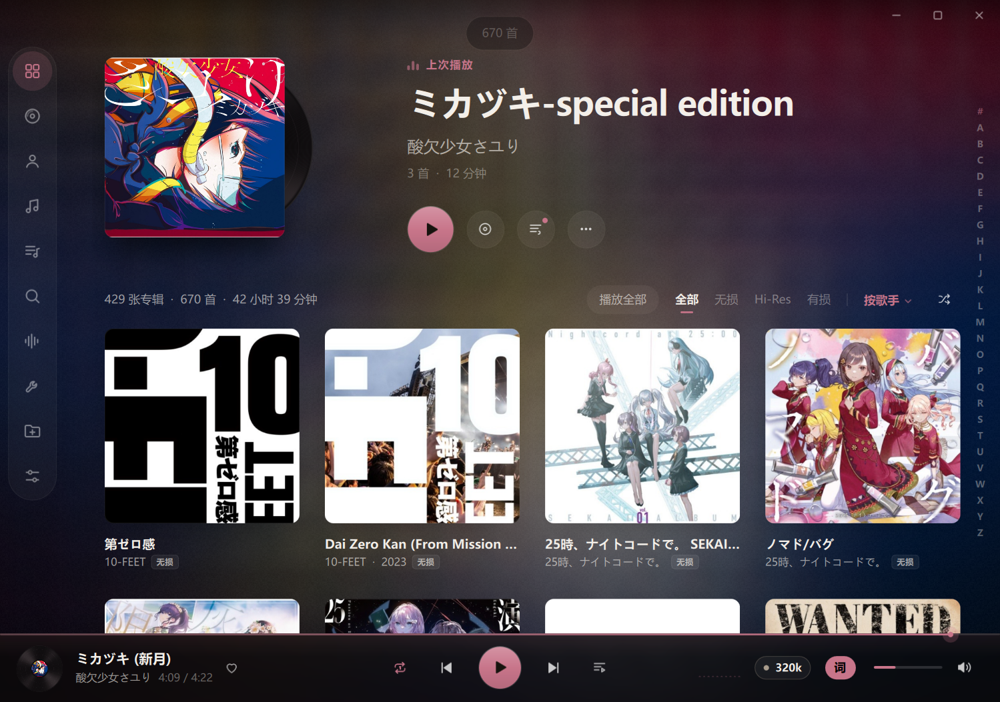
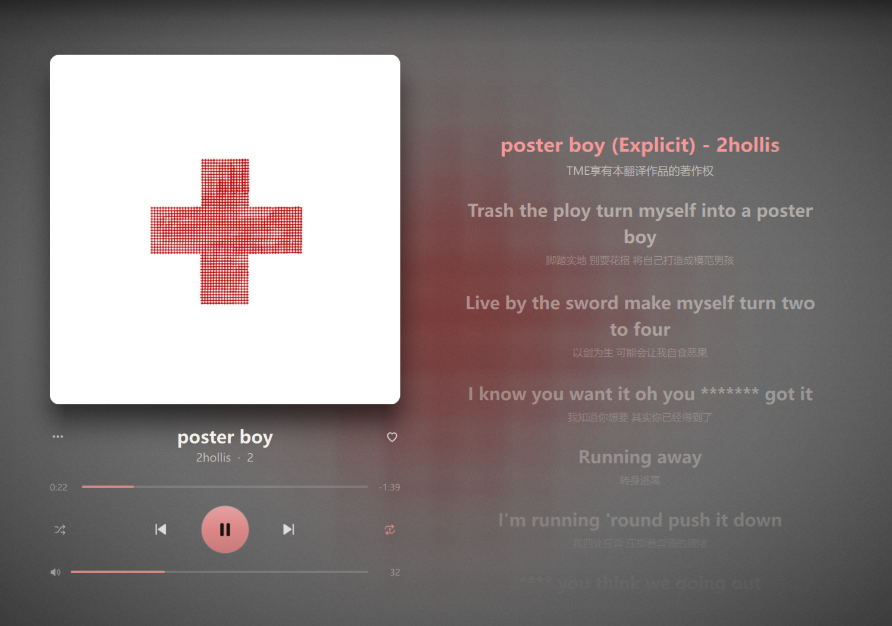
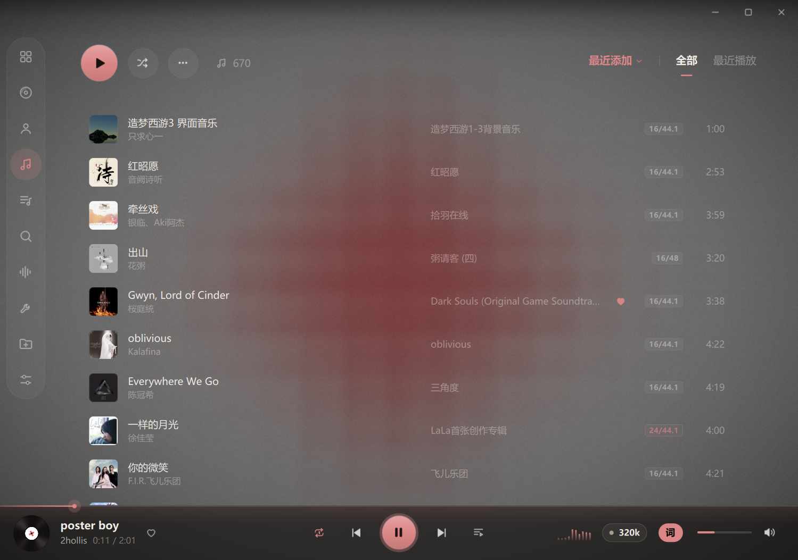
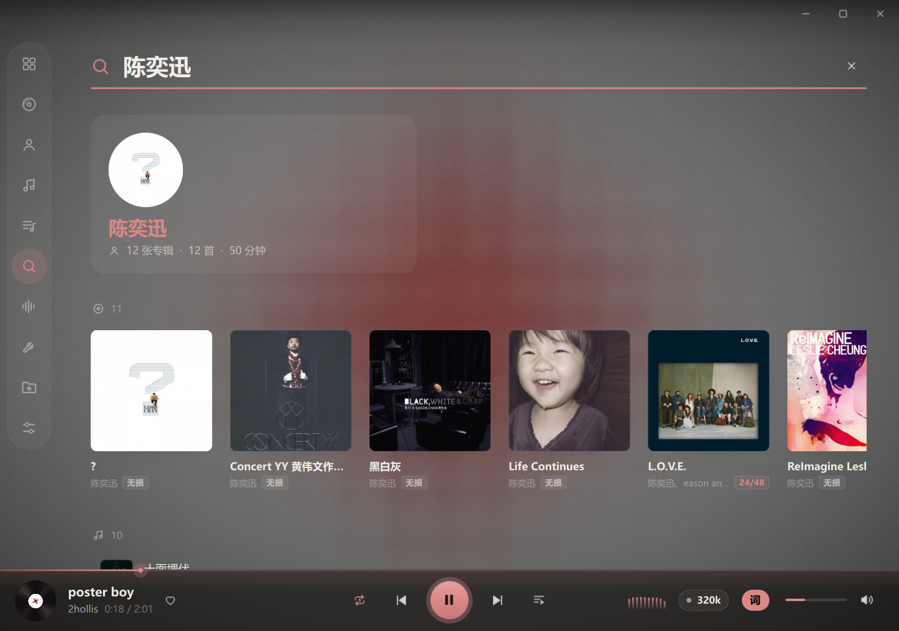

# Shiyu Player

基于 **C++17** 与 **Qt 6 Quick (QML)** 开发的 Windows 本地/在线音频播放器（CMake 工程名 `KugouPlayer`）。

## 界面预览

| 专辑墙 | 正在播放 |
| :---: | :---: |
|  |  |
| **歌曲列表** | **本地搜索** |
|  |  |

## 主要功能

- **本地曲库管理**：目录扫描与增量缓存、文件夹实时监听、拼音索引、CUE 分轨解析、曲库整理与去重
- **音频解码与播放**：多格式音频标签解析（ID3 / FLAC / Ogg / RIFF / DSD / MP4 / APE / NCM 等）、播放队列、均衡器与 FFT 频谱可视化
- **歌词与封面**：内嵌/在线歌词匹配与批量补全、桌面歌词（支持鼠标穿透）、专辑封面墙与本地借用/在线补全
- **在线与歌单**：在线曲库检索与流式播放（支持边听边存）、歌单管理与导入、播放历史记录
- **工具集成**：加密音频格式解密转换

## 目录结构

```text
.
├── CMakeLists.txt
├── player_core/      # 播放器内核静态库（标签解析、曲库、播放引擎、歌词/封面/在线模块）
│   ├── include/
│   ├── src/
│   └── third_party/
└── player_ui/        # Qt 6 Quick 界面层与服务绑定
    ├── qml/          # QML 页面、弹窗、播放岛、桌面歌词等组件
    ├── src/          # C++ Service / Model / WindowHelper
    ├── shaders/      # QSB 着色器效果
    └── resources/    # 图标与静态资源
```

## 构建要求

- **操作系统**：Windows（x64）
- **编译器**：MSVC（Visual Studio 2022 / BuildTools，需支持 C++17）
- **构建工具**：CMake 3.21+、Ninja（或 Visual Studio 生成器）
- **依赖框架**：Qt 6.4+（需包含 `Core`、`Gui`、`Quick`、`QuickControls2`、`ShaderTools`、`Svg`）

## 编译运行

在 **x64 Native Tools Command Prompt for VS 2022**（或已配置 `vcvars64` 与 Qt 路径的终端）中执行：

```powershell
cmake -B b -G Ninja -DCMAKE_PREFIX_PATH="D:/Qt/6.8.3/msvc2022_64"
cmake --build b --target KugouPlayer -j 8
```

如需运行 QML 静态检查：

```powershell
cmake --build b --target KugouPlayer_qmllint
```

编译完成后，可执行文件位于 `b/player_ui/KugouPlayer.exe`。
